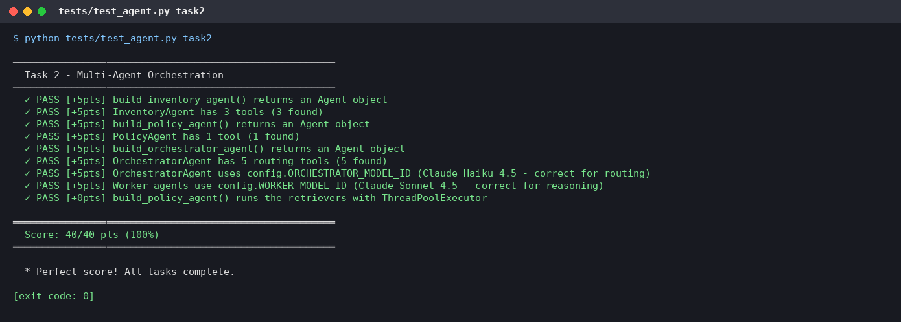
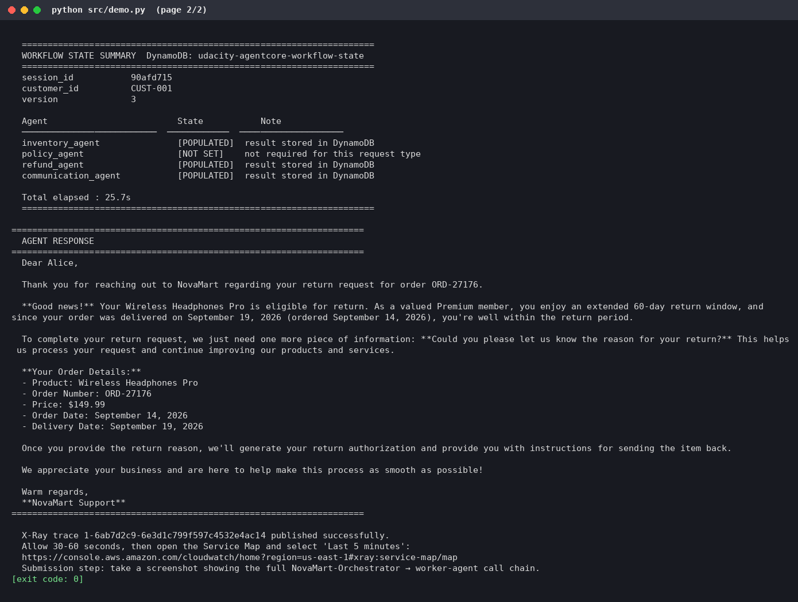

# NovaMart: Multi-Agent Customer Support on Amazon Bedrock AgentCore

> **Udacity AWS Agent Engineer project.** This is an enterprise multi-agent architecture built with the [Strands Agents SDK](https://github.com/strands-agents/sdk-python) and deployed to **Amazon Bedrock AgentCore Runtime**. It uses Bedrock Knowledge Bases on S3 Vectors, Bedrock Guardrails, AgentCore Memory, DynamoDB shared workflow state, and CloudWatch + X-Ray observability.

**Status:** deployed end to end on a real AWS account (us-east-1). The course's automated grading suite scored **120 / 120 (100%)**. See [End-to-end results](#end-to-end-results).

The system automatically routes customer support requests to specialist agents. It retrieves grounded policy knowledge through **parallel multi-agent RAG**, enforces enterprise safety guardrails, and keeps a shared workflow state that every agent can read and update.


---

## Contents

- [Architecture](#architecture)
- [Agents and tools](#agents-and-tools)
- [Tech stack](#tech-stack)
- [Repository layout](#repository-layout)
- [Prerequisites](#prerequisites)
- [Setup and deployment](#setup-and-deployment)
- [End-to-end results](#end-to-end-results)
- [Bugs found and fixed](#bugs-found-and-fixed)
- [Known issues and limitations](#known-issues-and-limitations)
- [Cost notes](#cost-notes)
- [Cleanup](#cleanup)
- [Testing reference](#testing-reference)
- [Troubleshooting](#troubleshooting)
- [Resources](#resources)

---

## Architecture

```
Customer Request
      │
OrchestratorAgent (Claude Haiku 4.5 - routes requests, manages WorkflowState)
      │
   ┌──┼──────────────────────────┬──────────────────┐
   │  │                          │                  │
InventoryAgent    PolicyAgent    RefundAgent    CommunicationAgent
(DynamoDB)     (Multi-Agent RAG)  (DynamoDB)     (synthesizes response)
                     │
         ┌───────────┼───────────┐
    ReturnsPolicyRetriever  ShippingPolicyRetriever  WarrantyPolicyRetriever
    (Bedrock KB)          (Bedrock KB)              (Bedrock KB)
         └───────── run in PARALLEL ───────────┘

Shared State: DynamoDB WorkflowStateTable (with optimistic locking)
```

The orchestrator follows six routing rules:

| Rule | Trigger | Action |
|------|---------|--------|
| 1 | Every request | Call `initialize_session` first |
| 2 | Order status / return / refund | `route_to_inventory_agent`, then `route_to_refund_agent` |
| 3 | Policy questions (windows, rates, terms) | `route_to_policy_agent` |
| 4 | Account questions ("what is my tier?") | `route_to_inventory_agent`, never the PolicyAgent |
| 5 | Maths / calculations | No Inventory, Policy or Refund; go straight to Communication |
| 6 | Every request, last step | `route_to_communication_agent` composes the final reply. The orchestrator never answers directly. |


### Key features

- **Multi-agent RAG:** the PolicyAgent runs 3 specialised retriever sub-agents in parallel with a `ThreadPoolExecutor` and merges their results.
- **Shared workflow state:** a DynamoDB `WorkflowStateTable` with optimistic locking (version-based conditional writes).
- **Enterprise guardrails:** a Bedrock Guardrail (content filters, PII anonymise/block, denied topics, profanity) attached to every agent's model, including the retriever sub-agents.
- **Observability:** every request becomes one X-Ray trace (Orchestrator → Worker → Knowledge Base). Logs go to CloudWatch, both locally and from the deployed runtime.
- **Knowledge Bases on S3 Vectors:** one vector bucket with one index per Knowledge Base, created by CloudFormation. Embeddings use Titan Text Embeddings v2.

---

## Agents and tools

| Agent | Model | Responsibility | Tools |
|-------|-------|----------------|-------|
| **OrchestratorAgent** | Claude Haiku 4.5 (temp 0.0) | Routes requests; creates and updates WorkflowState | `initialize_session`, `route_to_inventory_agent`, `route_to_policy_agent`, `route_to_refund_agent`, `route_to_communication_agent` |
| **InventoryAgent** | Claude Sonnet 4.5 (temp 0.1) | Gathers order and customer facts from DynamoDB | `check_order_status`, `get_customer_tier`, `list_customer_orders` |
| **PolicyAgent** | Claude Sonnet 4.5 (temp 0.2) | Coordinates parallel retrieval from 3 KBs and synthesises the answer | `search_all_policies` (fans out to 3 retriever sub-agents, temp 0.0) |
| **RefundAgent** | Claude Sonnet 4.5 (temp 0.1) | Return/refund eligibility: 30 days for Standard, 60 days for Premium, delivered orders only | `get_inventory_context`, `initiate_refund` |
| **CommunicationAgent** | Claude Sonnet 4.5 (temp 0.3) | Drafts the final, empathetic customer-facing reply | `get_full_workflow_context` |


---

## Tech stack

| Layer | Technology |
|---|---|
| Agent framework | Strands Agents SDK (Python 3.12) |
| Models | Claude Haiku 4.5 (routing), Claude Sonnet 4.5 (workers) on Amazon Bedrock |
| Hosting | Amazon Bedrock AgentCore Runtime (CodeZip, arm64, PUBLIC / HTTP), deployed with the **AgentCore CLI 0.30.0** (`@aws/agentcore`, CDK under the hood) |
| Memory | AgentCore Memory (SESSION_SUMMARY strategy, 7-day event expiry) |
| RAG | Bedrock Knowledge Bases, Titan Text Embeddings v2 (1024-d), Amazon S3 Vectors |
| Safety | Amazon Bedrock Guardrails (Standard tier, cross-region profile) |
| Data | Amazon DynamoDB (orders, customers, workflow state), Amazon S3 (policy documents) |
| Infrastructure | AWS CloudFormation (`infrastructure/starter_stack.yaml`) |
| Observability | CloudWatch Logs, AWS X-Ray, CloudWatch Transaction Search |

---

## Repository layout

```
.
├── config.py                      # Central configuration (CloudFormation exports + .env)
├── requirements.txt
├── .env.example                   # Template - copy to .env (never commit .env)
├── agentcore/                     # AgentCore CLI project used by `agentcore deploy`
│   ├── agentcore.json             # Runtime definition (as deployed: role + env vars)
│   ├── aws-targets.json           # Deployment target (account + region)
│   └── cdk/                       # CDK app the CLI deploys with
├── src/
│   ├── agent_orchestrator.py      # The 5-agent system, guardrail, deploy, memory, observability, serve entry point
│   ├── agent_observability.py     # X-Ray tracing + CloudWatch logging layer
│   ├── agentcore_cli.py           # AgentCore CLI wrapper (stage code, deploy, status)
│   ├── bedrock_kb_retrieval.py    # KB retrieval helper
│   ├── agent_utils.py             # Terminal trace UI
│   └── demo.py                    # One-shot demo with a visual trace
├── infrastructure/
│   ├── starter_stack.yaml         # DynamoDB, S3, S3 Vectors, IAM role, log group
│   ├── seed_data.py               # Seeds customers, orders and policy documents
│   └── cleanup.py                 # Deletes everything the project created
├── scripts/
│   └── create_knowledge_bases.py  # API alternative to the console KB wizard (create + sync + fill .env)
├── tests/test_agent.py            # Automated grading suite (120 points)
├── diagrams/                      # Architecture diagrams
└── docs/
    ├── FIXES.md                   # Bugs found in the starter and how they were fixed
    ├── fixes.diff                 # Full patch against the original starter
    └── screenshots/               # Terminal captures of the real end-to-end run
```

---

## Prerequisites

- **Python 3.12**, which matches the deployed runtime.
- An **AWS account** in `us-east-1` with access to Bedrock (Claude Haiku 4.5, Claude Sonnet 4.5, Titan Text Embeddings v2), Bedrock AgentCore, DynamoDB, S3, S3 Vectors, CloudFormation, IAM (`CAPABILITY_NAMED_IAM`), CloudWatch and X-Ray. The AgentCore CLI deploys through AWS CDK, so the account needs a CDK bootstrap (`CDKToolkit`), which the first deploy creates.
- **Node.js 20+** with the AgentCore CLI, and [**uv**](https://docs.astral.sh/uv/getting-started/installation/), which the CLI uses to download arm64 wheels:

  ```bash
  npm install -g @aws/agentcore@0.30.0
  agentcore --version
  ```

  > The CLI replaces the older Python `bedrock-agentcore-starter-toolkit`. If you have the old one installed, uninstall it (`pip uninstall bedrock-agentcore-starter-toolkit`). CLI 0.30.0 warns that Node 22+ will be required for updates published after January 2027.

---

## Setup and deployment

This is the exact command flow used for the verified run.

### 1. Install dependencies and configure the environment

```bash
python3.12 -m venv .venv && source .venv/bin/activate
pip install -r requirements.txt
cp .env.example .env
export AWS_REGION=us-east-1 AWS_DEFAULT_REGION=us-east-1
```

### 2. Deploy the foundation stack

```bash
aws cloudformation deploy \
  --stack-name udacity-agentcore \
  --template-file infrastructure/starter_stack.yaml \
  --capabilities CAPABILITY_NAMED_IAM \
  --region us-east-1
```

This creates three DynamoDB tables, the policy-documents bucket, an S3 Vectors bucket with three indexes (`returns-`, `shipping-` and `warranty-policy-index`), the AgentCore execution role and the log group.

### 3. Check the configuration and seed the data

```bash
python config.py                     # prints every resolved resource name
python infrastructure/seed_data.py   # 4 customers, 11 orders, 6 policy documents
```

### 4. Create and sync the three Knowledge Bases

**Option A: API (used in the verified run)**

```bash
python scripts/create_knowledge_bases.py
```

This creates `novamart-returns-policy-kb`, `novamart-shipping-policy-kb` and `novamart-warranty-policy-kb`. Each is a self-managed KB using Titan v2 embeddings (1024, FLOAT32) on the stack's S3 Vectors bucket and index, with one S3 data source per policy prefix. The script syncs each KB, waits until ingestion is `COMPLETE` and writes the IDs into `.env`. It uses the stack's execution role as the KB service role; that role trusts `bedrock.amazonaws.com` and already has S3 read, `s3vectors:*` and `bedrock:InvokeModel`.

**Option B: console.** Go to Bedrock → Knowledge Bases → Create (self-managed, existing S3 Vectors store). Use the following settings, then click **Sync** on each data source and paste the IDs into `.env` as `RETURNS_KB_ID`, `SHIPPING_KB_ID` and `WARRANTY_KB_ID`.

| Setting | Returns KB | Shipping KB | Warranty KB |
|---|---|---|---|
| S3 data bucket | *Policy Bucket* from `python config.py` | same | same |
| S3 prefix | `policies/returns/` | `policies/shipping/` | `policies/warranty/` |
| Embedding model | `amazon.titan-embed-text-v2:0` | same | same |
| Vector bucket | *Vector Bucket* from `python config.py` | same | same |
| Vector index | `returns-policy-index` | `shipping-policy-index` | `warranty-policy-index` |

Do **not** use *Quick create a new vector store*.

### 5. Test locally

```bash
python tests/test_agent.py task2
python tests/test_agent.py task5
python src/demo.py
python infrastructure/seed_data.py         # reseed (see note below)
python src/agent_orchestrator.py test      # 3 live scenarios, X-Ray traces published
```

> **Reseed note:** a successful return scenario changes the order's status to `return initiated`, after which it is no longer eligible (by design, see [fix 4](docs/FIXES.md)). Re-run `seed_data.py` before each full run of the scenarios or the test suite.

### 6. Deploy to AgentCore Runtime

```bash
python src/agent_orchestrator.py deploy
```

This runs a 6-step pipeline:

1. Build the graph.
2. Create the Guardrail and publish a numbered version.
3. Stage `build/runtime/` and run `agentcore deploy -y` (CDK stack `AgentCore-udacity-default`).
4. Create AgentCore Memory.
5. Configure observability (CloudWatch logs, X-Ray Transaction Search, runtime environment variables).
6. Deploy the optional gateway, which is skipped unless Lambda tool functions are configured.

Copy the printed values into `.env`:

```
AGENTCORE_RUNTIME_ARN=<printed arn>
GUARDRAIL_ID=<printed id>
GUARDRAIL_VERSION=<printed version>
```

### 7. Verify

```bash
python infrastructure/seed_data.py
python tests/test_agent.py all
python src/agent_orchestrator.py invoke "I want to return my wireless headphones from order ORD-27176" CUST-001
python src/agent_orchestrator.py invoke "What is the return policy for premium customers?" CUST-002
python src/agent_orchestrator.py invoke 'How much would 5 items at $29.99 be with a 10% discount?' CUST-003
agentcore status
```

For the course submission, also take a screenshot of the **X-Ray Service Map** (CloudWatch → X-Ray traces → Service map) after a live run. Allow about 10 minutes for the first spans to be indexed.

---

## End-to-end results

All results below come from one real run on 26 Sep 2026 in `us-east-1`. The screenshots are terminal captures of that run's logs, with credentials scrubbed. The account ID and resource IDs are visible; they are not secrets.

### Deployed resources

| Resource | Value |
|---|---|
| Foundation stack | `udacity-agentcore` (CREATE_COMPLETE) |
| Knowledge Bases | returns `PD8S9AR9AT`, shipping `JH2SOUPQEE`, warranty `8G7AOXWUTD`. Each sync: 2 documents scanned, 2 indexed, 0 failed. |
| Guardrail | `i8p6i1mpnel9`, version `1` |
| AgentCore Runtime | `udacity_agentcore_runtime-ETnTL1HEGn`: READY (PUBLIC / HTTP) |
| AgentCore Memory | `udacity_agentcore_memory-Q347dYFGUi`: ACTIVE |
| CLI / CDK stack | `AgentCore-udacity-default` |
| Observability | Log group `/aws/bedrock/agentcore/udacity-agentcore`; X-Ray → CloudWatch Logs (Transaction Search ACTIVE, 100% indexing) |

### Grading suite: 120 / 120

| Task | Area | Score |
|---|---|---|
| Task 2 | Multi-agent orchestration | **40 / 40** |
| Task 3 | AgentCore Runtime + Guardrails | **20 / 20** |
| Task 4 | Memory | **15 / 15** |
| Task 5 | Bedrock Knowledge Bases | **25 / 25** |
| Task 6 | Observability | **20 / 20** |
| **Total** | `python tests/test_agent.py all` | **120 / 120 (100%)** |

No checks failed. One informational line said "no NovaMart traces in X-Ray yet", which is expected right after enabling Transaction Search (indexing takes minutes). Traces were visible in X-Ray afterwards.


*`tests/test_agent.py all`, final page: Task 5 parallel retrieval, Task 6 observability, and **Score: 120/120 pts (100%)**.*

### Local runs

- **`demo.py`:** routed Orchestrator → Inventory → Refund → Communication, with a total elapsed time of **25.7 s** and an X-Ray trace published. On this run the RefundAgent asked the customer for a return reason rather than initiating the refund straight away.
- **`agent_orchestrator.py test`:** all 3 scenarios routed as specified.
  - Return: Inventory → Refund, `initiate_refund` called and a return created.
  - Policy: 3 KB retrievers ran in parallel.
  - Maths: straight to Communication.

  All three X-Ray traces were published.
- **Task 5 test:** the three retrievers returned in parallel in 7.1 s (5.8 s in the full-suite run).

### Deployed runtime: the three demo scenarios (`invoke`)

| Scenario | Outcome |
|---|---|
| **Return:** "I want to return my wireless headphones from order ORD-27176" (CUST-001, Premium) | A friendly "return approved" email to Alice. It cites the Premium 60-day window and the $149.99 refund, then asks for the return reason before issuing a label. **On this run the model did not call `initiate_refund`** (the order stayed `delivered`), whereas the local test run did. LLM tool-calling varies here; see [Known issues](#known-issues-and-limitations). |
| **Policy:** "What is the return policy for premium customers?" (CUST-002) | A grounded answer from the Knowledge Bases: a 60-day Premium window versus 30 days Standard, the qualification criteria ($500+ per year or 20+ orders), Premium benefits (free expedited shipping, 3-year electronics warranty, 4-hour priority support) and a 6-step return process. |
| **Maths:** "How much would 5 items at $29.99 be with a 10% discount?" (CUST-003) | Correct: 5 × $29.99 = $149.95, minus $14.995, for a **total of $134.96**. It was routed straight to Communication, as required. **Cosmetic issue:** the reply begins with some of the CommunicationAgent's reasoning ("I can see that this is a pricing calculation question… Let me provide a helpful response…") before the customer email. |

| Return | Policy | Maths |
|---|---|---|
|  |  |  |

### Deployment


*`python src/agent_orchestrator.py deploy`: all 6 steps; the runtime is READY and the memory ACTIVE (about 4.4 minutes).*


*`agentcore status`: runtime deployed and READY.*


*Three Knowledge Bases created through the API and synced (ingestion COMPLETE, 0 failures).*

<details>
<summary><b>Full screenshot gallery (all 23 captures)</b></summary>

| # | Step | Screenshot |
|---|---|---|
| 01 | CloudFormation stack deploy + outputs | [01-stack.png](docs/screenshots/01-stack.png) |
| 02 | `python config.py` | [02-config.png](docs/screenshots/02-config.png) |
| 03 | `seed_data.py` | [03-seed.png](docs/screenshots/03-seed.png) |
| 04 | Knowledge Bases created + synced | [04-kb-sync.png](docs/screenshots/04-kb-sync.png) |
| 05 | `test_agent.py task2`: 40/40 | [05-test-task2.png](docs/screenshots/05-test-task2.png) |
| 06 | `test_agent.py task5`: 25/25 | [p1](docs/screenshots/06-test-task5-p1.png) · [p2](docs/screenshots/06-test-task5-p2.png) |
| 07 | `demo.py` | [p1](docs/screenshots/07-demo-p1.png) · [p2](docs/screenshots/07-demo-p2.png) |
| 08 | Reseed | [08-reseed.png](docs/screenshots/08-reseed.png) |
| 09 | `agent_orchestrator.py test` (3 scenarios) | [p1](docs/screenshots/09-local-test-p1.png) · [p2](docs/screenshots/09-local-test-p2.png) · [p3](docs/screenshots/09-local-test-p3.png) · [p4](docs/screenshots/09-local-test-p4.png) · [p5](docs/screenshots/09-local-test-p5.png) · [p6](docs/screenshots/09-local-test-p6.png) |
| 10 | `agent_orchestrator.py deploy` | [10-deploy.png](docs/screenshots/10-deploy.png) |
| 11 | `test_agent.py all`: 120/120 | [p1](docs/screenshots/11-test-all-p1.png) · [p2](docs/screenshots/11-test-all-p2.png) |
| 12 | `invoke`: return scenario | [12-invoke-return.png](docs/screenshots/12-invoke-return.png) |
| 13 | `invoke`: policy scenario | [13-invoke-policy.png](docs/screenshots/13-invoke-policy.png) |
| 14 | `invoke`: maths scenario | [14-invoke-math.png](docs/screenshots/14-invoke-math.png) |
| 15 | `agentcore status` | [15-agentcore-status.png](docs/screenshots/15-agentcore-status.png) |






</details>

---

## Bugs found and fixed

Before deploying, the starter was audited and exercised against a mocked AWS harness. Eleven issues were fixed; details are in **[docs/FIXES.md](docs/FIXES.md)** and the full patch is in [docs/fixes.diff](docs/fixes.diff). The main ones:

- **S3 Vectors indexes:** `AMAZON_BEDROCK_METADATA` is now non-filterable, so KB ingestion stays within the filterable-metadata limit.
- **Refund safety:** only `delivered` orders are eligible. This prevents refunds on cancelled or processing orders and double refunds of the same order.
- **Session isolation:** agents' conversation histories are cleared per request, so one customer's context no longer leaks into the next session on a shared graph.
- **Concurrency:** the deployed `serve` entry point serialises concurrent invocations.
- **Guardrail:** now also attached to the three retriever sub-agents, and the version lookup always returns a numbered version.
- Explicit Bedrock region on every model, `.env` support in `seed_data.py`, `Decimal` → `int` for state versions, and the real elapsed time in `demo.py`.

> **Note:** three of these fixes touch files the course lists as "never modify": `infrastructure/starter_stack.yaml`, `infrastructure/seed_data.py` and `src/demo.py`. `config.py` and `tests/test_agent.py` are unchanged.

---

## Known issues and limitations

- **Memory is provisioned but not used by the agents.** AgentCore Memory (SESSION_SUMMARY, 7 days) is created and ACTIVE, which satisfies Task 4, but no agent reads or writes memory events, so there is no cross-turn recall yet.
- **`invoke` uses a fresh session each time.** Each CLI invoke generates a new session ID, so a follow-up (for example, sending the return reason) starts from scratch rather than continuing the previous conversation.
- **Return tool-calling varies between runs.** When no return reason is given, the RefundAgent sometimes asks for one instead of calling `initiate_refund`. The local test called it; the deployed invoke did not. A system-prompt default such as "use *customer request* if no reason is given" would make this deterministic.
- **Return window is measured from the order date.** Eligibility counts days since `order_date`, while the policy documents say "from delivery". Orders don't store a delivery date, so this is an approximation.
- **Reasoning leakage.** The CommunicationAgent sometimes prefixes its reply with meta-commentary (seen in the maths scenario).
- **X-Ray indexing at 100%.** The observability step sets the account-level X-Ray indexing rule (`Default`) to 100%. That is useful for development, but it applies to the **whole account** and adds span-indexing cost. Lower it (for example to 1–5%) for anything long-lived.
- **Node.js version.** AgentCore CLI 0.30.0 runs on Node 20 but warns that Node 22+ will be required for updates after January 2027.

---

## Cost notes

These are rough estimates, not billing data. The full verified run (stack, KB creation and sync, about 10 multi-agent executions across the demo, local test, test suites and three invokes, plus deployment) was estimated at **roughly $1–2**. That is dominated by Claude Sonnet/Haiku tokens, plus a few cents of Titan embeddings and small DynamoDB, S3, S3 Vectors and CloudWatch charges. At rest, the runtime, memory, Knowledge Bases (on S3 Vectors) and DynamoDB (on-demand) bill almost entirely per use or per GB, so idle cost is small. The main ongoing item is span indexing while X-Ray indexing stays at 100%.

---

## Cleanup

When you're finished (after taking the submission screenshots):

```bash
python infrastructure/cleanup.py          # dry run - lists what would be deleted
python infrastructure/cleanup.py --yes    # deletes it (run twice; KB/AgentCore deletions are async)
```

This deletes, in dependency order:

1. The three Knowledge Bases and their data sources.
2. The AgentCore CLI stack `AgentCore-udacity-default` (runtime) and the Memory.
3. The Guardrail.
4. The policy bucket contents.
5. The `udacity-agentcore` stack (tables, buckets, vector indexes, role, log group).
6. The runtime log groups.

> ⚠️ **Don't add `--disable-transaction-search` if anything else in the account uses AgentCore Observability or CloudWatch Transaction Search.** It turns Transaction Search off for the whole account, not just this project. The `CDKToolkit` bootstrap stack is shared and is left in place.

---

## Testing reference

```bash
python tests/test_agent.py task2   # Multi-agent orchestration (40)
python tests/test_agent.py task3   # AgentCore Runtime + Guardrails (20)
python tests/test_agent.py task4   # Memory (15)
python tests/test_agent.py task5   # Knowledge Bases (25)
python tests/test_agent.py task6   # Observability (20)
python tests/test_agent.py all     # Full suite (120)

python src/agent_orchestrator.py test    # 3 live scenarios, locally
python src/agent_orchestrator.py chat    # interactive session with a colour-coded agent trace
python src/agent_orchestrator.py invoke "<question>" CUST-00X   # call the deployed runtime

agentcore invoke '{"prompt": "I want to return my order ORD-27176", "customer_id": "CUST-001"}'
agentcore status
agentcore logs
```

---

## Troubleshooting

| Symptom | What to check |
|---|---|
| `config.py` shows missing tables or buckets | Stack `udacity-agentcore` must be `CREATE_COMPLETE` in `us-east-1`. These values come from CloudFormation exports only. |
| KB IDs show `(not yet created)` | Expected before step 4. Run `scripts/create_knowledge_bases.py` or paste the console IDs into `.env`. |
| A return scenario says "already initiated" | Reseed with `python infrastructure/seed_data.py`. |
| `check_order_status` key-schema error | The Orders key is `customer_id` + `order_id`; pass both. |
| `agentcore: command not found` or old toolkit help | Install Node 20+ and `npm i -g @aws/agentcore@0.30.0`; uninstall `bedrock-agentcore-starter-toolkit`. |
| `agentcore deploy` fails packaging | Needs `uv` on PATH and internet access. See `agentcore/.cli/logs/`. |
| CDK / CloudFormation error on deploy | Check stack `AgentCore-udacity-default`, fix the cause and re-run `deploy`; it is idempotent. |
| No X-Ray traces | Each run prints `X-Ray trace <id> published`. Use "Last 5 minutes" in the console. First-time indexing can take about 10 minutes. |

---

## Resources

- [Strands Agents SDK](https://github.com/strands-agents/sdk-python)
- [Amazon Bedrock AgentCore developer guide](https://docs.aws.amazon.com/bedrock-agentcore/latest/devguide/)
- [AgentCore CLI (`@aws/agentcore`)](https://github.com/aws/agentcore-cli)
- [Bedrock Knowledge Bases](https://docs.aws.amazon.com/bedrock/latest/userguide/knowledge-base.html)
- [Bedrock Guardrails](https://docs.aws.amazon.com/bedrock/latest/userguide/guardrails-create.html) · [safeguard tiers](https://docs.aws.amazon.com/bedrock/latest/userguide/guardrails-tiers.html)
- [DynamoDB conditional writes / optimistic locking](https://docs.aws.amazon.com/amazondynamodb/latest/developerguide/Expressions.ConditionExpressions.html)

---

*Based on the Udacity AWS Agent Engineer course starter, "Enterprise Multi-Agent Architecture with Amazon Bedrock AgentCore". Course materials remain subject to Udacity's terms.*
