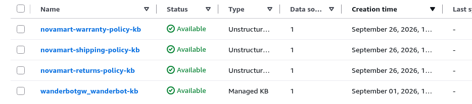

# NovaMart: Multi-Agent Customer Support on Amazon Bedrock AgentCore

> **Udacity AWS Agent Engineer project.** Multi-agent customer support built with the [Strands Agents SDK](https://github.com/strands-agents/sdk-python) on **Amazon Bedrock AgentCore Runtime**, with Bedrock Knowledge Bases (S3 Vectors), Bedrock Guardrails, AgentCore Memory, DynamoDB shared workflow state and CloudWatch + X-Ray observability.

**Status:** deployed end to end in us-east-1. Course grading suite `tests/test_agent.py all`: **120 / 120 (100%)**.

## Rubric map

| Criterion | Where proven | Screenshot / file |
|---|---|---|
| Grading suite 120/120 | `python tests/test_agent.py all` against the live deployment | [24-test-all-terminal.png](docs/screenshots/24-test-all-terminal.png) · [25 (top)](docs/screenshots/25-test-all-terminal-top.png) · [text output](docs/test-all-output.txt) |
| X-Ray service map | CloudWatch → X-Ray trace map: Orchestrator → 4 agents → 3 KBs | [22-xray-service-map.png](docs/screenshots/22-xray-service-map.png) · [traces](docs/screenshots/23-xray-traces.png) · [indexing 100%](docs/screenshots/21-xray-indexing.png) |
| Models & temperatures | [`config.py`](config.py) (`ORCHESTRATOR_MODEL_ID` Claude Haiku 4.5, `WORKER_MODEL_ID` Claude Sonnet 4.5); `build_*_agent()` in [`src/agent_orchestrator.py`](src/agent_orchestrator.py): orchestrator 0.0, retrievers 0.0, inventory 0.1, refund 0.1, policy coordinator 0.2, communication 0.3 | Task 2 40/40: [05-test-task2.png](docs/screenshots/05-test-task2.png) |
| Guardrail config + validation | `create_guardrail()` / `_apply_guardrail()` in [`src/agent_orchestrator.py`](src/agent_orchestrator.py): content filters + DENY topics (competitor products, pricing negotiations, legal threats; arithmetic explicitly allowed). Guardrail `i8p6i1mpnel9` v1 attached to all agents incl. retrievers | Task 3 20/20 in [test output](docs/test-all-output.txt); maths passes through: [14-invoke-math.png](docs/screenshots/14-invoke-math.png) |
| Runtime deploy | `deploy` via AgentCore CLI ([`src/agentcore_cli.py`](src/agentcore_cli.py), [`agentcore/agentcore.json`](agentcore/agentcore.json)) | [10-deploy.png](docs/screenshots/10-deploy.png) · [15-agentcore-status.png](docs/screenshots/15-agentcore-status.png) |
| Memory | `configure_memory()`, `_load_memory_context()`, `_save_memory_turn()`; multi-turn via `--session-id` | [17](docs/screenshots/17-session-turn1.png) · [18](docs/screenshots/18-session-turn2.png) · [19-memory-events.png](docs/screenshots/19-memory-events.png) |
| Knowledge Bases | 3 KBs (returns/shipping/warranty) on S3 Vectors, queried in parallel by `build_policy_agent()` | [kb-list](docs/screenshots/kb-console/kb-list.png) · [04-kb-sync.png](docs/screenshots/04-kb-sync.png) · [knowledge-bases.json](docs/knowledge-bases.json) |
| Routing scenarios | return → Inventory → Refund → Communication; policy → Policy (3 parallel KBs) → Communication; maths → Communication only | [12-invoke-return](docs/screenshots/12-invoke-return.png) · [13-invoke-policy](docs/screenshots/13-invoke-policy.png) · [14-invoke-math](docs/screenshots/14-invoke-math.png) · [16-return-dynamodb](docs/screenshots/16-return-dynamodb.png) |

## Deviations from the starter (read first)

- **Knowledge Bases were created by script, not by clicking through the console.** [`scripts/create_knowledge_bases.py`](scripts/create_knowledge_bases.py) creates and syncs the three KBs with the exact settings the course specifies (Titan Embed v2, S3 Vectors bucket/index from the stack, `policies/<domain>/` prefixes). Console screenshots prove the result: [list](docs/screenshots/kb-console/kb-list.png), [returns](docs/screenshots/kb-console/kb-returns-1.png), [shipping](docs/screenshots/kb-console/kb-shipping-1.png), [warranty](docs/screenshots/kb-console/kb-warranty-1.png).
- **Code changes are confined to the student file** `src/agent_orchestrator.py`. The "never modify" files `infrastructure/starter_stack.yaml`, `infrastructure/seed_data.py`, `src/demo.py`, `config.py` and `tests/test_agent.py` are byte-identical to the Udacity starter. Other differences from the starter, none of them graded code: `.env.example` gains one `AGENTCORE_MEMORY_ID=` placeholder; `agentcore/agentcore.json` is rewritten by the deploy pipeline (as designed); additions are `scripts/create_knowledge_bases.py`, `tests/test_known_issues.py` (offline tests) and `docs/`. The live CloudFormation stack was deployed from an earlier `starter_stack.yaml` with one extra non-filterable metadata key; the file has since been reverted and the suite re-run at 120/120 (details in [docs/FIXES.md](docs/FIXES.md)).

## Required screenshots


*`python tests/test_agent.py all` against the live deployment, with the starter files restored: **Score: 120/120 pts (100%)**.*


*X-Ray trace map: Client → NovaMart-Orchestrator → InventoryAgent, RefundAgent, PolicyAgent, CommunicationAgent and KnowledgeBase:returns / shipping / warranty.*

---

## Contents

- [Architecture](#architecture) · [Agents and tools](#agents-and-tools) · [Tech stack](#tech-stack) · [Repository layout](#repository-layout)
- [Prerequisites](#prerequisites) · [Setup and deployment](#setup-and-deployment)
- [Final results](#final-results) · [Known issues](#known-issues) · [Cleanup](#cleanup) · [Testing reference](#testing-reference)
- More: [docs/FIXES.md](docs/FIXES.md) (bug list + round-by-round narrative) · [docs/SCREENSHOTS.md](docs/SCREENSHOTS.md) (full gallery) · [docs/OPERATIONS.md](docs/OPERATIONS.md) (cost notes + troubleshooting)

---

## Architecture

```
Customer Request
      │
OrchestratorAgent (Claude Haiku 4.5 - routes requests, manages WorkflowState)
      │
   ┌──┼──────────────────────────┬──────────────────┐
   │  │                          │                  │
InventoryAgent    PolicyAgent    RefundAgent    CommunicationAgent
(DynamoDB)     (Multi-Agent RAG)  (DynamoDB)     (synthesizes response)
                     │
         ┌───────────┼───────────┐
    ReturnsPolicyRetriever  ShippingPolicyRetriever  WarrantyPolicyRetriever
    (Bedrock KB)          (Bedrock KB)              (Bedrock KB)
         └───────── run in PARALLEL ───────────┘

Shared State: DynamoDB WorkflowStateTable (with optimistic locking)
```

The orchestrator follows six routing rules:

| Rule | Trigger | Action |
|------|---------|--------|
| 1 | Every request | Call `initialize_session` first |
| 2 | Order status / return / refund | `route_to_inventory_agent`, then `route_to_refund_agent` |
| 3 | Policy questions (windows, rates, terms) | `route_to_policy_agent` |
| 4 | Account questions ("what is my tier?") | `route_to_inventory_agent`, never the PolicyAgent |
| 5 | Maths / calculations | No Inventory, Policy or Refund; go straight to Communication |
| 6 | Every request, last step | `route_to_communication_agent` composes the final reply. The orchestrator never answers directly. |


### Key features

- **Multi-agent RAG:** the PolicyAgent runs 3 specialised retriever sub-agents in parallel with a `ThreadPoolExecutor` and merges their results.
- **Shared workflow state:** a DynamoDB `WorkflowStateTable` with optimistic locking (version-based conditional writes).
- **Enterprise guardrails:** a Bedrock Guardrail (content filters, PII anonymise/block, denied topics, profanity) attached to every agent's model, including the retriever sub-agents.
- **Observability:** every request becomes one X-Ray trace (Orchestrator → Worker → Knowledge Base). Logs go to CloudWatch, both locally and from the deployed runtime.
- **Conversation memory:** AgentCore Memory (SESSION_SUMMARY). Each turn loads the session's earlier turns and summaries of the customer's past sessions, and saves the new turn. `invoke --session-id` continues a conversation.
- **Knowledge Bases on S3 Vectors:** one vector bucket with one index per Knowledge Base, created by CloudFormation. Embeddings use Titan Text Embeddings v2.

---

## Agents and tools

| Agent | Model | Responsibility | Tools |
|-------|-------|----------------|-------|
| **OrchestratorAgent** | Claude Haiku 4.5 (temp 0.0) | Routes requests; creates and updates WorkflowState | `initialize_session`, `route_to_inventory_agent`, `route_to_policy_agent`, `route_to_refund_agent`, `route_to_communication_agent` |
| **InventoryAgent** | Claude Sonnet 4.5 (temp 0.1) | Gathers order and customer facts from DynamoDB | `check_order_status`, `get_customer_tier`, `list_customer_orders` |
| **PolicyAgent** | Claude Sonnet 4.5 (temp 0.2) | Coordinates parallel retrieval from 3 KBs and synthesises the answer | `search_all_policies` (fans out to 3 retriever sub-agents, temp 0.0) |
| **RefundAgent** | Claude Sonnet 4.5 (temp 0.1) | Return/refund eligibility: 30 days for Standard, 60 days for Premium, counted from delivery, delivered orders only. Initiates the return for explicit, eligible requests. | `get_inventory_context`, `initiate_refund` |
| **CommunicationAgent** | Claude Sonnet 4.5 (temp 0.3) | Drafts the final, empathetic customer-facing reply | `get_full_workflow_context` |


---

## Tech stack

| Layer | Technology |
|---|---|
| Agent framework | Strands Agents SDK (Python 3.12) |
| Models | Claude Haiku 4.5 (routing), Claude Sonnet 4.5 (workers) on Amazon Bedrock |
| Hosting | Amazon Bedrock AgentCore Runtime (CodeZip, arm64, PUBLIC / HTTP), deployed with the **AgentCore CLI 0.30.0** (`@aws/agentcore`, CDK under the hood) |
| Memory | AgentCore Memory (SESSION_SUMMARY strategy, 7-day event expiry) |
| RAG | Bedrock Knowledge Bases, Titan Text Embeddings v2 (1024-d), Amazon S3 Vectors |
| Safety | Amazon Bedrock Guardrails (Standard tier, cross-region profile) |
| Data | Amazon DynamoDB (orders, customers, workflow state), Amazon S3 (policy documents) |
| Infrastructure | AWS CloudFormation (`infrastructure/starter_stack.yaml`) |
| Observability | CloudWatch Logs, AWS X-Ray, CloudWatch Transaction Search |

---

## Repository layout

```
.
├── config.py                      # Central configuration (CloudFormation exports + .env)
├── requirements.txt
├── .env.example                   # Template - copy to .env (never commit .env)
├── agentcore/                     # AgentCore CLI project used by `agentcore deploy`
│   ├── agentcore.json             # Runtime definition (as deployed: role + env vars)
│   ├── aws-targets.json           # Deployment target (account + region)
│   └── cdk/                       # CDK app the CLI deploys with
├── src/
│   ├── agent_orchestrator.py      # The 5-agent system, guardrail, deploy, memory, observability, serve entry point
│   ├── agent_observability.py     # X-Ray tracing + CloudWatch logging layer
│   ├── agentcore_cli.py           # AgentCore CLI wrapper (stage code, deploy, status)
│   ├── bedrock_kb_retrieval.py    # KB retrieval helper
│   ├── agent_utils.py             # Terminal trace UI
│   └── demo.py                    # One-shot demo with a visual trace
├── infrastructure/
│   ├── starter_stack.yaml         # DynamoDB, S3, S3 Vectors, IAM role, log group
│   ├── seed_data.py               # Seeds customers, orders and policy documents
│   └── cleanup.py                 # Deletes everything the project created
├── scripts/
│   └── create_knowledge_bases.py  # API alternative to the console KB wizard (create + sync + fill .env)
├── tests/
│   ├── test_agent.py              # Automated grading suite (120 points, unchanged)
│   └── test_known_issues.py       # Offline pytest suite for the known-issue fixes (moto)
├── diagrams/                      # Architecture diagrams
└── docs/
    ├── FIXES.md                   # Bugs found in the starter and how they were fixed
    ├── fixes.diff                 # Full patch against the original starter
    └── screenshots/               # Terminal captures of the real end-to-end run
```

---

## Prerequisites

- **Python 3.12**, which matches the deployed runtime.
- An **AWS account** in `us-east-1` with access to Bedrock (Claude Haiku 4.5, Claude Sonnet 4.5, Titan Text Embeddings v2), Bedrock AgentCore, DynamoDB, S3, S3 Vectors, CloudFormation, IAM (`CAPABILITY_NAMED_IAM`), CloudWatch and X-Ray. The AgentCore CLI deploys through AWS CDK, so the account needs a CDK bootstrap (`CDKToolkit`), which the first deploy creates.
- **Node.js 20+** with the AgentCore CLI, and [**uv**](https://docs.astral.sh/uv/getting-started/installation/), which the CLI uses to download arm64 wheels:

  ```bash
  npm install -g @aws/agentcore@0.30.0
  agentcore --version
  ```

  > The CLI replaces the older Python `bedrock-agentcore-starter-toolkit`. If you have the old one installed, uninstall it (`pip uninstall bedrock-agentcore-starter-toolkit`). CLI 0.30.0 warns that Node 22+ will be required for updates published after January 2027.

---

## Setup and deployment

This is the exact command flow used for the verified run.

### 1. Install dependencies and configure the environment

```bash
python3.12 -m venv .venv && source .venv/bin/activate
pip install -r requirements.txt
cp .env.example .env
export AWS_REGION=us-east-1 AWS_DEFAULT_REGION=us-east-1
```

### 2. Deploy the foundation stack

```bash
aws cloudformation deploy \
  --stack-name udacity-agentcore \
  --template-file infrastructure/starter_stack.yaml \
  --capabilities CAPABILITY_NAMED_IAM \
  --region us-east-1
```

This creates three DynamoDB tables, the policy-documents bucket, an S3 Vectors bucket with three indexes (`returns-`, `shipping-` and `warranty-policy-index`), the AgentCore execution role and the log group.

### 3. Check the configuration and seed the data

```bash
python config.py                     # prints every resolved resource name
python infrastructure/seed_data.py   # 4 customers, 11 orders, 6 policy documents
```

### 4. Create and sync the three Knowledge Bases

**Option A: API (used in the verified run)**

```bash
python scripts/create_knowledge_bases.py
```

This creates `novamart-returns-policy-kb`, `novamart-shipping-policy-kb` and `novamart-warranty-policy-kb`. Each is a self-managed KB using Titan v2 embeddings (1024, FLOAT32) on the stack's S3 Vectors bucket and index, with one S3 data source per policy prefix. The script syncs each KB, waits until ingestion is `COMPLETE` and writes the IDs into `.env`. It uses the stack's execution role as the KB service role; that role trusts `bedrock.amazonaws.com` and already has S3 read, `s3vectors:*` and `bedrock:InvokeModel`.

**Option B: console.** Go to Bedrock → Knowledge Bases → Create (self-managed, existing S3 Vectors store). Use the following settings, then click **Sync** on each data source and paste the IDs into `.env` as `RETURNS_KB_ID`, `SHIPPING_KB_ID` and `WARRANTY_KB_ID`.

| Setting | Returns KB | Shipping KB | Warranty KB |
|---|---|---|---|
| S3 data bucket | *Policy Bucket* from `python config.py` | same | same |
| S3 prefix | `policies/returns/` | `policies/shipping/` | `policies/warranty/` |
| Embedding model | `amazon.titan-embed-text-v2:0` | same | same |
| Vector bucket | *Vector Bucket* from `python config.py` | same | same |
| Vector index | `returns-policy-index` | `shipping-policy-index` | `warranty-policy-index` |

Do **not** use *Quick create a new vector store*.

**Console view of the three Knowledge Bases.** Each uses Titan Text Embeddings v2 on the stack's S3 Vectors store, with its data source on the matching `policies/<name>/` prefix and a completed sync. The console leaves the *S3 vector index* field blank, so the index names (`returns-policy-index`, `shipping-policy-index`, `warranty-policy-index`) are confirmed from the Bedrock API in [docs/knowledge-bases.json](docs/knowledge-bases.json).



### 5. Test locally

```bash
python tests/test_agent.py task2
python tests/test_agent.py task5
python src/demo.py
python infrastructure/seed_data.py         # reseed (see note below)
python src/agent_orchestrator.py test      # 3 live scenarios, X-Ray traces published
```

> **Reseed note:** a successful return changes the order's status to `Return Initiated`, after which it is no longer eligible (by design, see [fix 4](docs/FIXES.md)). Returns are now actually created by the return scenario, so re-run `seed_data.py` before each full run of the scenarios or the test suite.

### 6. Deploy to AgentCore Runtime

```bash
python src/agent_orchestrator.py deploy
```

This runs a 6-step pipeline:

1. Build the graph.
2. Create the Guardrail and publish a numbered version.
3. Stage `build/runtime/` and run `agentcore deploy -y` (CDK stack `AgentCore-udacity-default`).
4. Create AgentCore Memory.
5. Configure observability (CloudWatch logs, X-Ray Transaction Search, runtime environment variables).
6. Deploy the optional gateway, which is skipped unless Lambda tool functions are configured.

Copy the printed values into `.env`:

```
AGENTCORE_RUNTIME_ARN=<printed arn>
GUARDRAIL_ID=<printed id>
GUARDRAIL_VERSION=<printed version>
AGENTCORE_MEMORY_ID=<printed memory id>   # enables memory for local runs too
```

The deployed runtime receives `AGENTCORE_MEMORY_ID` automatically.

### 7. Verify

```bash
python infrastructure/seed_data.py
python tests/test_agent.py all
python src/agent_orchestrator.py invoke "I want to return my wireless headphones from order ORD-27176" CUST-001
python src/agent_orchestrator.py invoke "What is the return policy for premium customers?" CUST-002
python src/agent_orchestrator.py invoke 'How much would 5 items at $29.99 be with a 10% discount?' CUST-003
agentcore status

# multi-turn: reuse the session id printed by the first call
python src/agent_orchestrator.py invoke "I want to return my phone case from order ORD-30001 - it's the wrong colour" CUST-004 --session-id demo1
python src/agent_orchestrator.py invoke "What was my return reference again?" CUST-004 --session-id demo1

# offline tests for the known-issue fixes (no AWS needed)
pip install pytest moto && pytest -q tests/test_known_issues.py
```

The X-Ray Service Map for the course submission is in CloudWatch → X-Ray traces → Service map (see [Final results](#final-results)). After the first live run, allow about 10 minutes for spans to be indexed.

---

## Final results

Live runs, us-east-1, 26 Sep 2026 (resource IDs visible; no credentials).

| Resource | Value |
|---|---|
| Foundation stack | `udacity-agentcore` |
| Knowledge Bases | returns `PD8S9AR9AT`, shipping `JH2SOUPQEE`, warranty `8G7AOXWUTD` (2/2 docs indexed each) |
| Guardrail | `i8p6i1mpnel9` v1 |
| Runtime | `udacity_agentcore_runtime-ETnTL1HEGn` READY |
| Memory | `udacity_agentcore_memory-Q347dYFGUi` ACTIVE, used every turn |

- **Grading suite:** 120/120 (Task 2 40, Task 3 20, Task 4 15, Task 5 25, Task 6 20). Offline tests `tests/test_known_issues.py`: 18/18.
- **Return** (CUST-001, ORD-27176): return created, reference `RET-27176-36065`, DynamoDB `Return Initiated`.
- **Policy** (CUST-002): grounded answer from all three KBs (Premium 60 days vs Standard 30).
- **Maths** (CUST-003): $134.96, routed straight to Communication, clean reply.
- **Multi-turn memory** (CUST-004): turn 2 recalled `RET-30001-36178` with no order id in the message.

Bug list, the round-1/round-2 narrative and all detailed results: **[docs/FIXES.md](docs/FIXES.md)**. Every screenshot: **[docs/SCREENSHOTS.md](docs/SCREENSHOTS.md)**.

---

## Known issues

- X-Ray `Default` indexing is set to 100% account-wide because Task 6 checks it; lower it after grading (`aws xray update-indexing-rule --name Default --rule '{"Probabilistic":{"DesiredSamplingPercentage":1}}'`).
- Memory summaries of past sessions are generated asynchronously; same-session turns are immediate.
- The refund backstop's "explicit return intent" check and the reply sanitiser are heuristic; prompts are the primary control.
- Seed data has only `estimated_delivery`, used as the delivery basis for return windows.

Cost notes and troubleshooting: [docs/OPERATIONS.md](docs/OPERATIONS.md).

---

## Cleanup

When you're finished (after taking the submission screenshots):

```bash
python infrastructure/cleanup.py          # dry run - lists what would be deleted
python infrastructure/cleanup.py --yes    # deletes it (run twice; KB/AgentCore deletions are async)
```

This deletes, in dependency order:

1. The three Knowledge Bases and their data sources.
2. The AgentCore CLI stack `AgentCore-udacity-default` (runtime) and the Memory.
3. The Guardrail.
4. The policy bucket contents.
5. The `udacity-agentcore` stack (tables, buckets, vector indexes, role, log group).
6. The runtime log groups.

> ⚠️ **Don't add `--disable-transaction-search` if anything else in the account uses AgentCore Observability or CloudWatch Transaction Search.** It turns Transaction Search off for the whole account, not just this project. The `CDKToolkit` bootstrap stack is shared and is left in place.

---

## Testing reference

```bash
python tests/test_agent.py task2   # Multi-agent orchestration (40)
python tests/test_agent.py task3   # AgentCore Runtime + Guardrails (20)
python tests/test_agent.py task4   # Memory (15)
python tests/test_agent.py task5   # Knowledge Bases (25)
python tests/test_agent.py task6   # Observability (20)
python tests/test_agent.py all     # Full suite (120)
pytest -q tests/test_known_issues.py  # Offline tests for the known-issue fixes

python src/agent_orchestrator.py test    # 3 live scenarios, locally
python src/agent_orchestrator.py chat    # interactive session with a colour-coded agent trace
python src/agent_orchestrator.py invoke "<question>" CUST-00X [--session-id ID]   # call the deployed runtime

agentcore invoke '{"prompt": "I want to return my order ORD-27176", "customer_id": "CUST-001"}'
agentcore status
agentcore logs
```

---

## More documentation

- [docs/FIXES.md](docs/FIXES.md) · [docs/SCREENSHOTS.md](docs/SCREENSHOTS.md) · [docs/OPERATIONS.md](docs/OPERATIONS.md)

---

## Resources

- [Strands Agents SDK](https://github.com/strands-agents/sdk-python)
- [Amazon Bedrock AgentCore developer guide](https://docs.aws.amazon.com/bedrock-agentcore/latest/devguide/)
- [AgentCore CLI (`@aws/agentcore`)](https://github.com/aws/agentcore-cli)
- [Bedrock Knowledge Bases](https://docs.aws.amazon.com/bedrock/latest/userguide/knowledge-base.html)
- [Bedrock Guardrails](https://docs.aws.amazon.com/bedrock/latest/userguide/guardrails-create.html) · [safeguard tiers](https://docs.aws.amazon.com/bedrock/latest/userguide/guardrails-tiers.html)
- [DynamoDB conditional writes / optimistic locking](https://docs.aws.amazon.com/amazondynamodb/latest/developerguide/Expressions.ConditionExpressions.html)

---

*Based on the Udacity AWS Agent Engineer course starter, "Enterprise Multi-Agent Architecture with Amazon Bedrock AgentCore". Course materials remain subject to Udacity's terms.*
