# Bugs found and fixed

Before the live deployment, the starter was audited and run against a mocked AWS harness (moto plus a scripted model). The issues below were found that way and fixed. The full patch against the original starter is in [`fixes.diff`](fixes.diff). All fixes were then confirmed by the real end-to-end run described in the [README](../README.md#end-to-end-results): `tests/test_agent.py all` scored **120/120**.

| # | Area / file | Problem | Fix |
|---|---|---|---|
| 1 (**reverted**) | `infrastructure/starter_stack.yaml` (S3 Vectors indexes) | Only `AMAZON_BEDROCK_TEXT` was declared non-filterable. Bedrock Knowledge Bases also write an `AMAZON_BEDROCK_METADATA` key, which then counts toward the S3 Vectors *filterable* metadata size limit and can make ingestion fail. | Added `AMAZON_BEDROCK_METADATA` to `NonFilterableMetadataKeys` on all three indexes. |
| 2 (**reverted**) | `infrastructure/seed_data.py` | Ignored `.env`, unlike `config.py`, so a custom `PROJECT_NAME` / `AWS_REGION` seeded the wrong tables. | Loads `.env` with `python-dotenv` when it is available. |
| 3 | `src/agent_orchestrator.py`, every `BedrockModel` | `region_name` wasn't set, so the model region came from the local AWS profile rather than `config.AWS_REGION`. | Pass `region_name=config.AWS_REGION` to all seven models. |
| 4 | RefundAgent eligibility check | Eligibility only compared dates. A cancelled or still-processing order counted as returnable, and the same delivered order could be refunded twice, because its status became `return initiated` but was never checked. | Only orders with status `delivered` are eligible, with a clear reason given for any other status. |
| 5 | WorkflowState `version` in tool outputs | DynamoDB returns `Decimal`, which leaked into tool results and JSON serialisation. | Cast to `int`. |
| 6 | Stateful worker and orchestrator agents | Strands `Agent` objects keep their conversation history. Because one graph is shared across requests (`test`, `invoke` in `serve` mode), each new session inherited the previous customers' messages. That leaks context between customers and grows the token count. | `agent.messages.clear()` before each routed call, each retriever call and each top-level request. |
| 7 | PolicyAgent retrievers | A missing KB ID caused a confusing runtime failure. | Returns an explicit "Knowledge Base not configured – set `<X>_KB_ID`" message. |
| 8 | Guardrail coverage | The three retriever sub-agents were built inside `build_policy_agent()` and never had the guardrail attached. | They are exposed as `policy_agent.retriever_agents` and passed to `_apply_guardrail()`. |
| 9 | `create_guardrail()` when the guardrail already exists | Took the *last listed* version, which isn't necessarily the highest, and fell back to `DRAFT` when no numbered version existed. The tests require a numbered version. | Uses the highest numbered version, or publishes one with `create_guardrail_version()`. |
| 10 | `serve` mode (deployed runtime) | Two concurrent invocations on the shared Strands orchestrator raise a concurrency error. | Invocations are serialised with a lock. |
| 11 (**reverted**) | `src/demo.py` | The summary always printed `elapsed=0`. | Measures the real elapsed time (the live demo run reported 25.7 s). |

## Files on the course's "Files to Never Modify" list

Fixes 1, 2 and 11 originally changed three starter files that the course asks students not to modify. They have been **reverted**, and `infrastructure/starter_stack.yaml`, `infrastructure/seed_data.py` and `src/demo.py` are now byte-for-byte identical to the Udacity starter. `config.py` and `tests/test_agent.py` were never changed. The live CloudFormation stack used for the screenshots was deployed from the earlier version of `starter_stack.yaml` with the extra `AMAZON_BEDROCK_METADATA` key; the diff files below still show those historical patches.

`src/agent_orchestrator.py` is the student implementation file, so changing it is expected. `agentcore/agentcore.json` is rewritten by the deploy pipeline itself (runtime role and environment variables), which is how the project is designed to work.

---

# Round 2: fixes for the README's "Known issues"

The patch for this round is in [`fixes-round2.diff`](fixes-round2.diff).

These fixes address the issues found in the first live run. The source changes are in `src/agent_orchestrator.py` (the student file) and `.env.example` (the `seed_data.py` part of fix 14 was later reverted). There is a new offline test file, `tests/test_known_issues.py` (17 tests, using pytest and moto). `tests/test_agent.py` and `config.py` are still **unchanged**.

| # | Known issue | Fix |
|---|---|---|
| 12 | **AgentCore Memory was created but never used** | Each turn now goes through `_prepare_turn()` and `_finish_turn()`. Before the orchestrator runs, `list_events` loads the recent turns of *this* session, and `list_memory_records` loads SESSION_SUMMARY records of the customer's *earlier* sessions (namespace `/summaries/{customer_id}/`). The resulting context block is stored in WorkflowState (`memory_context`), added to the orchestrator prompt, and prepended to the Inventory, Refund and Communication worker prompts. After the reply, the USER and ASSISTANT turn is written back with `create_event` (actor = customer ID, session = session ID). The memory ID comes from `AGENTCORE_MEMORY_ID`: the deploy prints it, adds it to the runtime environment, and you copy it into `.env`. Without it, or with `AGENT_MEMORY_ENABLED=false`, every memory call is skipped. Memory errors are logged and never break a request. |
| 13 | **`invoke` created a new runtime session on every call** | `invoke "<msg>" [CUST-ID] --session-id <id>` (or `NOVAMART_SESSION_ID`) reuses a session, and the CLI prints the session ID to continue with. The AgentCore `runtimeSessionId` is now derived deterministically from the session ID (`_runtime_session_id`). On the server, `_begin_turn()` starts a new turn on the existing WorkflowState row: it clears the previous turn's agent columns, bumps `turn` and `version`, and stores `current_request` and `memory_context`. The shared Strands agents' histories are still cleared on every request, so customers stay isolated. Continuity comes from WorkflowState and AgentCore Memory, not from in-process history. |
| 14 | **Return window counted from the order date** | `_compute_eligibility()` is now a module-level function that counts days from `delivered_date`. If that is missing, it uses `estimated_delivery` when that date is already in the past, and otherwise falls back to `order_date`. The result reports `days_since_delivery`, `days_since_order` and `date_basis`. The `seed_data.py` change that wrote `delivered_date` was reverted to keep that file identical to the starter; seeded orders now use `estimated_delivery`, and every seeded verdict is unchanged. |
| 15 | **The return invoke didn't call `initiate_refund`** | The RefundAgent prompt now says to call `initiate_refund` immediately for an eligible, explicit return request, using the customer's reason or `Customer requested return (no reason given)`, and never to ask for a reason first. A question like "Can I return…?" still only reports eligibility. There is also a deterministic backstop in `route_to_refund_agent`: if the tools reported `eligible: true`, the request is an explicit return instruction (`_explicit_return_intent`), and no refund succeeded, the same `initiate_refund` logic runs in code. The grading suite has no test that expects the agent to ask for a reason. |
| 16 | **The maths reply leaked reasoning text** | The CommunicationAgent prompt has a strict output-format section (start with the greeting; no commentary, `Subject:` line or `---`). `_final_customer_text()` also removes narration blocks and paragraphs (such as "workflow", "Let me compose…" or "final response") before and after separators, as well as a leading `Subject:` line. It runs on the CommunicationAgent output before it is stored, and again at every entry point (`test`, `chat`, `serve`). |
| 17 | **Account X-Ray indexing forced to 100%** | **Not changed, on purpose.** Task 6 of `tests/test_agent.py` (`test_6_2_xray_tracing_enabled`, 10 points) requires the account's `Default` indexing rule to be exactly 100% and `AGENT_TRACE_SAMPLING_RATE=1.0`. The value is set by `enable_transaction_search()` in the pre-written `src/agent_observability.py`. Lowering it, or making it opt-in, would fail the graded check, so it stays at 100% and the README explains how to lower it after grading. |

---

# Round 3: review fixes (12 Oct 2026)

| # | Issue | Fix |
|---|---|---|
| 18 | The CLI/serve entry points fell back to the orchestrator's own text (`str(response)`) when the Communication Agent's output was missing from WorkflowState, so in that edge case the orchestrator could write the customer reply. | New `_customer_reply()` in `src/agent_orchestrator.py`: the reply is always the Communication Agent's output. If the LLM skipped the mandatory final `route_to_communication_agent` call, that same tool is run deterministically (via `orchestrator.finalize`), with its normal `expected_version` state update. New test `test_reply_always_from_communication_agent` (18/18 pass). |
| 19 | `.env` (resource IDs only, no credentials) was tracked despite `.gitignore`. | Removed from tracking; `.env.example` keeps placeholders. |

---

## Detailed end-to-end results (round 1 and round 2)

Everything below comes from real runs on 26 Sep 2026 in `us-east-1`. The screenshots are terminal captures of those runs' logs, with credentials scrubbed. The account ID and resource IDs are visible; they are not secrets.

There were two rounds:

- **Round 1:** the first deployment, which produced the original "Known issues".
- **Round 2:** the known-issue fixes, followed by a re-deploy and re-verification. Unless marked otherwise, the results below are from round 2.

### Deployed resources

| Resource | Value |
|---|---|
| Foundation stack | `udacity-agentcore` (CREATE_COMPLETE) |
| Knowledge Bases | returns `PD8S9AR9AT`, shipping `JH2SOUPQEE`, warranty `8G7AOXWUTD`. Each sync: 2 documents scanned, 2 indexed, 0 failed. |
| Guardrail | `i8p6i1mpnel9`, version `1` |
| AgentCore Runtime | `udacity_agentcore_runtime-ETnTL1HEGn`: READY (PUBLIC / HTTP), updated in place by the round-2 deploy |
| AgentCore Memory | `udacity_agentcore_memory-Q347dYFGUi`: ACTIVE, now **used** by the agents (`AGENTCORE_MEMORY_ID` in the runtime environment) |
| CLI / CDK stack | `AgentCore-udacity-default` |
| Observability | Log group `/aws/bedrock/agentcore/udacity-agentcore`; X-Ray → CloudWatch Logs (Transaction Search ACTIVE, 100% indexing) |

### Grading suite: 120 / 120 (after the fixes)

| Task | Area | Score |
|---|---|---|
| Task 2 | Multi-agent orchestration | **40 / 40** |
| Task 3 | AgentCore Runtime + Guardrails | **20 / 20** |
| Task 4 | Memory | **15 / 15** |
| Task 5 | Bedrock Knowledge Bases | **25 / 25** |
| Task 6 | Observability | **20 / 20** |
| **Total** | `python tests/test_agent.py all` | **120 / 120 (100%)** |

No checks failed, in either round. The offline tests for the fixes, `tests/test_known_issues.py`, pass 17/17.

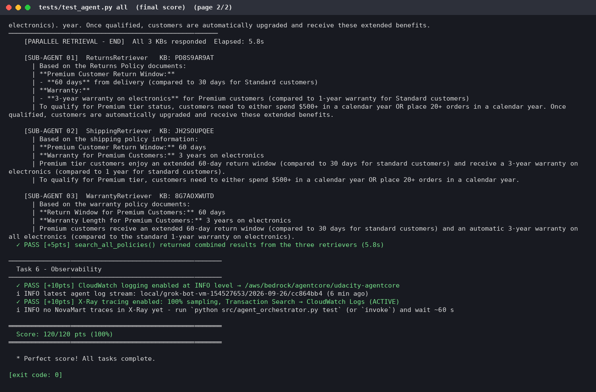
*`tests/test_agent.py all` after the round-2 re-deploy: **Score: 120/120 pts (100%)**.*

**Re-run with the starter's files restored (26 Sep 2026, 21:09 SAST).** After `starter_stack.yaml`, `seed_data.py` and `demo.py` were reverted to the exact starter versions and the data was reseeded with the original `seed_data.py`, the full suite was run again against the live deployment: **120/120, no failures**. Terminal screenshots are below, and the full text output is in [docs/test-all-output.txt](test-all-output.txt).

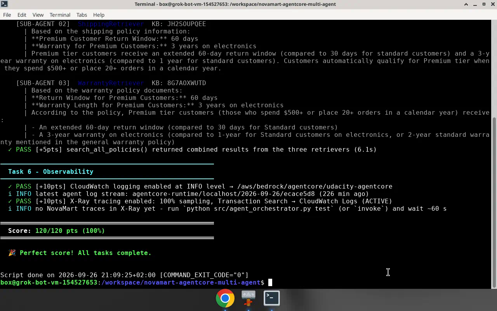
*Live terminal: Task 5 and Task 6 checks and **Score: 120/120 pts (100%)**.* Earlier tasks: [25-test-all-terminal-top.png](screenshots/25-test-all-terminal-top.png).

### Deployed runtime: the three demo scenarios (`invoke`)

| Scenario | Outcome (round 2) |
|---|---|
| **Return:** "I want to return my wireless headphones from order ORD-27176" (CUST-001, Premium) | **The return was created.** Alice received a confirmation with return reference `RET-27176-36065`, the $149.99 refund, packing and label instructions, and the note that her order was delivered on 18 Sep 2026, within the Premium 60-day window counted *from delivery*. DynamoDB confirms `status = Return Initiated`, `return_reason = "Customer requested return (no reason given)"`. In round 1 the model asked for a reason and created nothing. |
| **Policy:** "What is the return policy for premium customers?" (CUST-002) | A grounded answer from the three Knowledge Bases: a 60-day Premium window versus 30 days Standard, the qualification criteria ($500+ per year or 20+ orders), the 6-step return process and Premium benefits (free expedited shipping, 3-year electronics warranty, 4-hour priority support). |
| **Maths:** "How much would 5 items at $29.99 be with a 10% discount?" (CUST-003) | $149.95 minus $14.995 gives **$134.96**, routed straight to Communication. **The reply now starts with "Hello!"**, with no leaked reasoning. In round 1 it began "I can see that this is a pricing calculation question…". |

| Return | Policy | Maths |
|---|---|---|
| 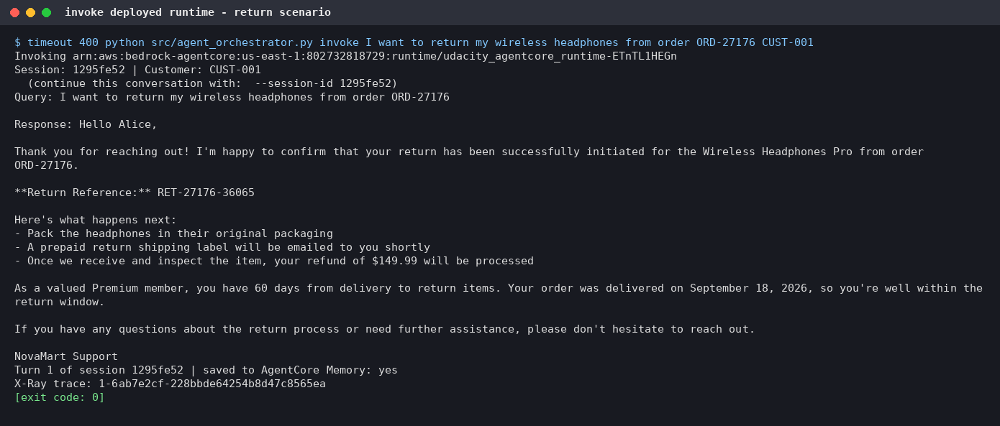 | 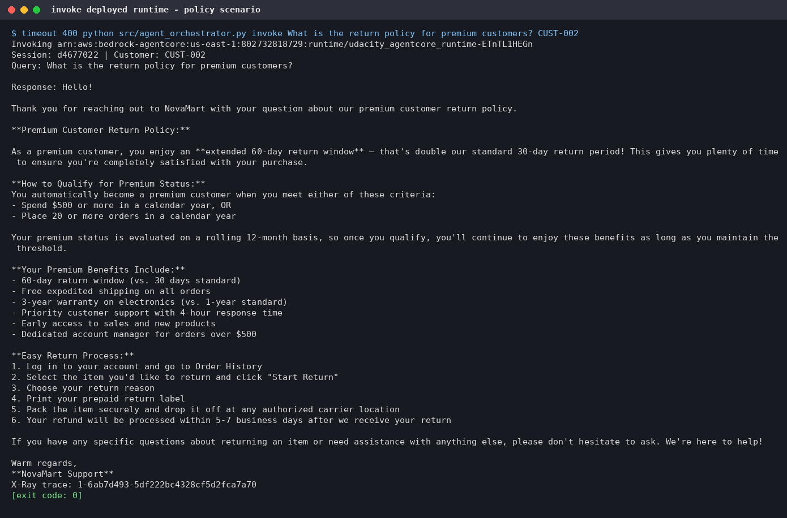 | 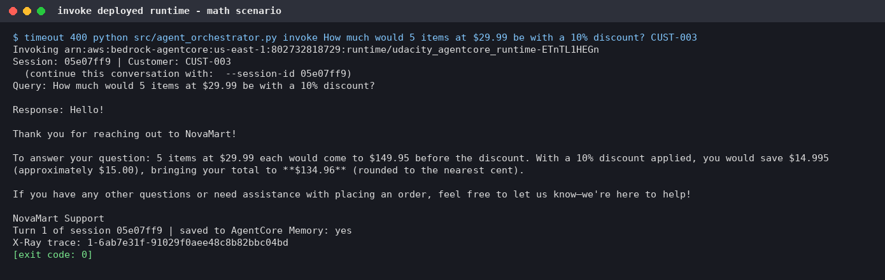 |

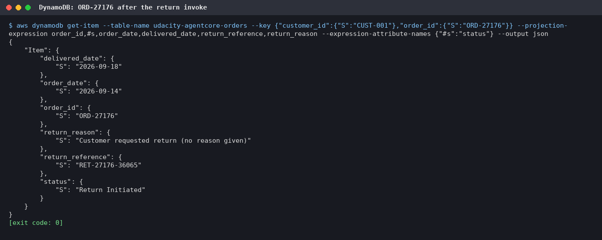
*The order record after the return invoke: `Return Initiated`, with return reference `RET-27176-36065`. (This capture predates restoring `seed_data.py` to the starter version, so it still shows a `delivered_date` field.)*

### Multi-turn session with AgentCore Memory

Two `invoke` calls sharing `--session-id demo172232` (CUST-004):

1. **Turn 1:** "I want to return my phone case from order ORD-30001 - it's the wrong colour". The return was created with reference `RET-30001-36178`, and the customer's own reason (`Wrong colour`) was stored.
2. **Turn 2:** "Sorry, what was my return reference again, and which item was it for?" This message contains **no order ID**. The answer was: "Your return reference is **RET-30001-36178**, and it's for the **Phone Case Slim** from order ORD-30001."

AgentCore Memory holds both turns (USER + ASSISTANT events for actor `CUST-004`, session `demo172232`). The WorkflowState row shows `turn=2`, with 966 characters of memory context loaded for the second turn.

| Turn 1 | Turn 2 |
|---|---|
| 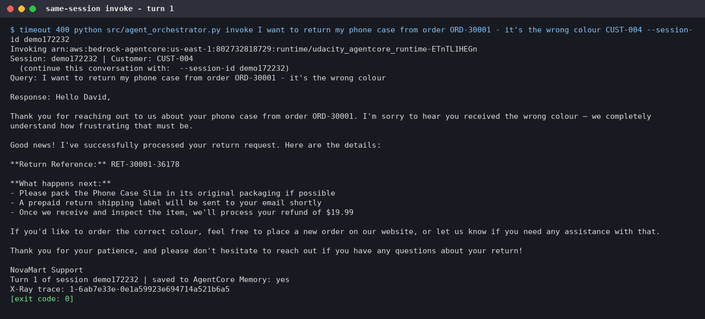 | 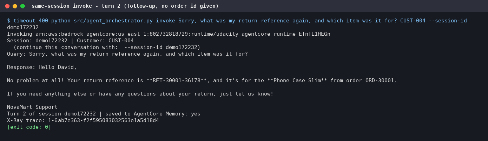 |

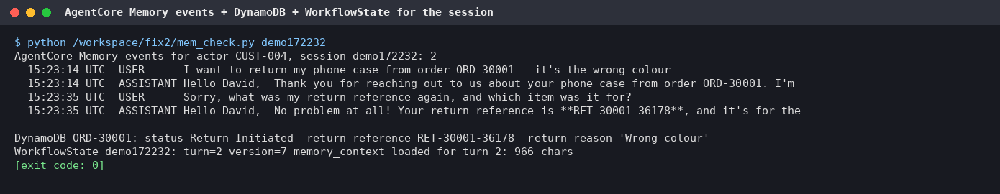
*`list_events` on the AgentCore Memory, plus the order and WorkflowState records for the session.*

### Observability (X-Ray)

Screenshots taken live in the CloudWatch X-Ray console (us-east-1, 1-hour range) after the round-2 runs:

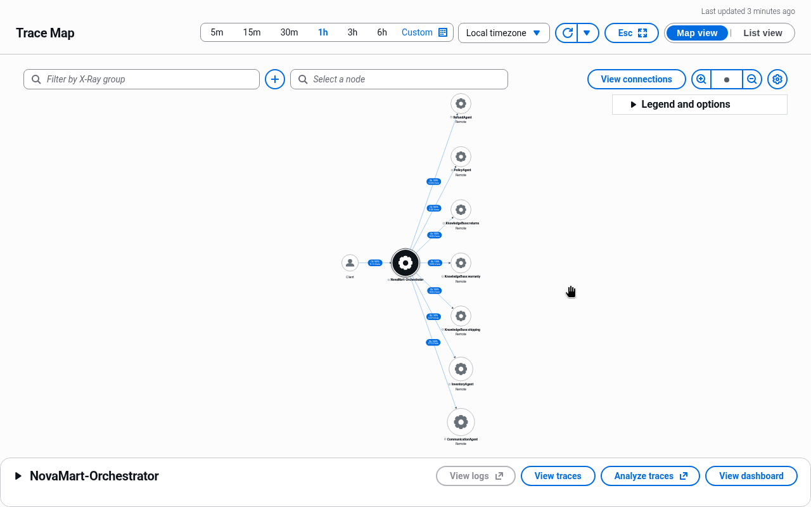
*Trace Map: **Client** → **NovaMart-Orchestrator**, fanning out to **InventoryAgent**, **RefundAgent**, **PolicyAgent** and **CommunicationAgent**, and to the three Knowledge Base nodes **KnowledgeBase:returns**, **KnowledgeBase:shipping** and **KnowledgeBase:warranty**.*

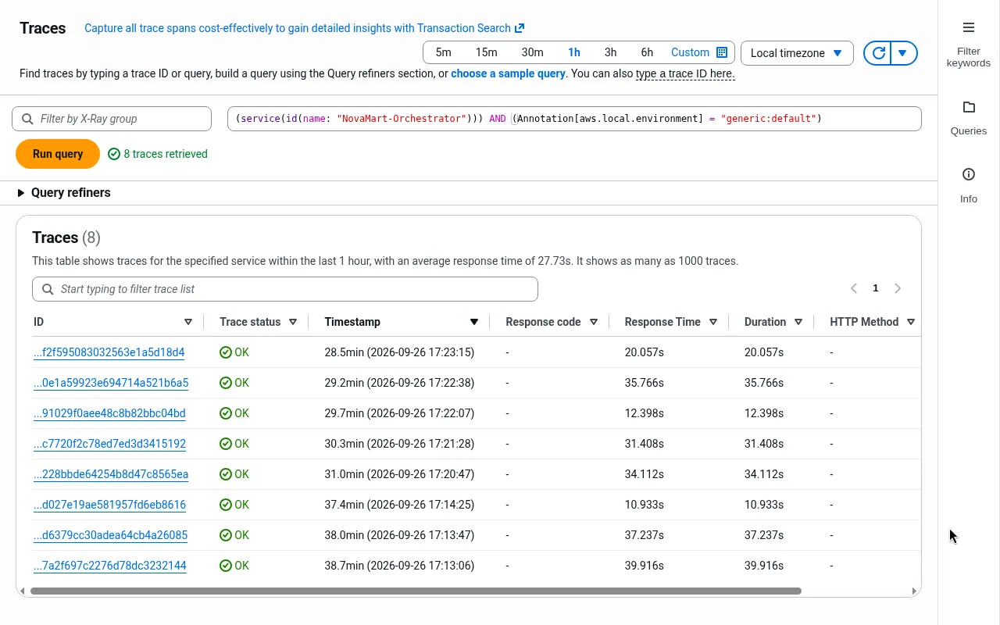
*Traces list for `NovaMart-Orchestrator`: **8 traces, all OK**, average response time **27.73 s** (17:13–17:23 SAST). These are the round-2 local `test` scenarios and deployed `invoke` calls.*

### Local runs

- **Round 1:**
  - `demo.py` routed Orchestrator → Inventory → Refund → Communication in **25.7 s**.
  - `agent_orchestrator.py test` routed all 3 scenarios as specified: Inventory → Refund for the return, 3 parallel KB retrievers for the policy question, and straight to Communication for the maths.
  - The Task 5 retrievers answered in parallel in 7.1 s.
- **Round 2:** `agent_orchestrator.py test` routed all 3 scenarios correctly again. The return called `initiate_refund` (`RET-27176-35607`), and the maths reply was clean.
- **Offline:** the mocked harness (moto plus a scripted model) ran every mode (`test`, `demo`, `chat`, `serve`, `deploy`, `invoke`) end to end, and pytest passed 17/17.

### Deployment

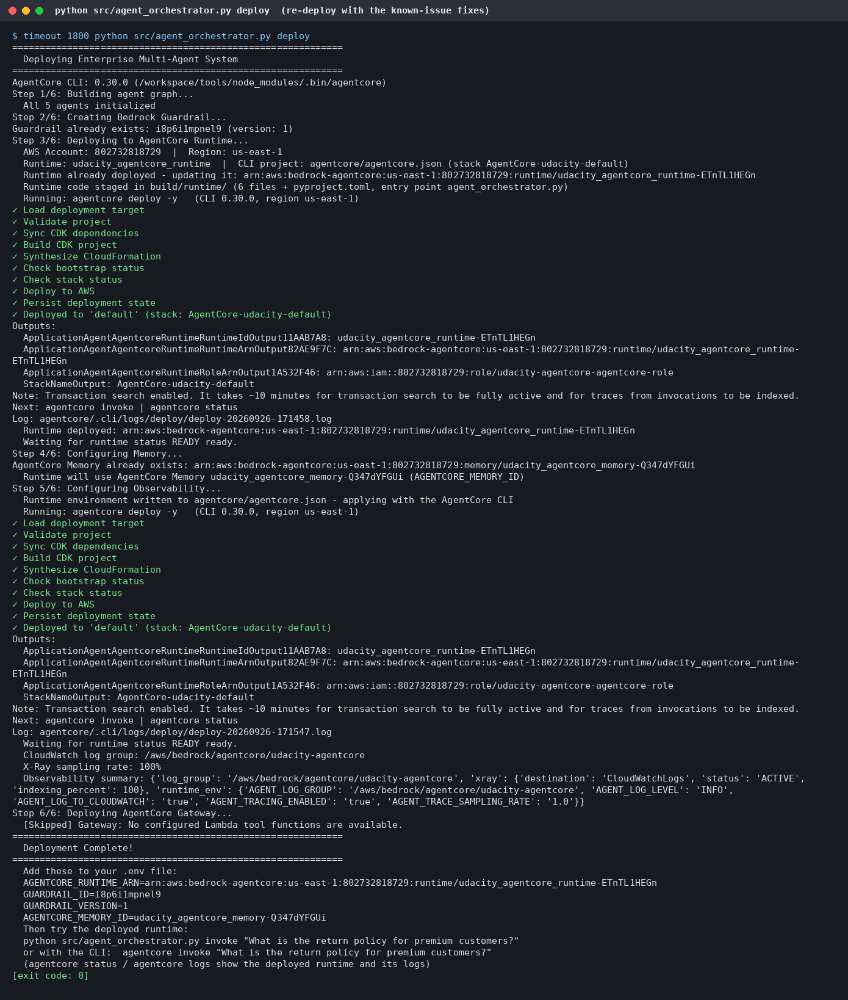
*Round-2 `deploy`: the runtime was updated in place, and Step 4 now adds `AGENTCORE_MEMORY_ID` to the runtime environment.*

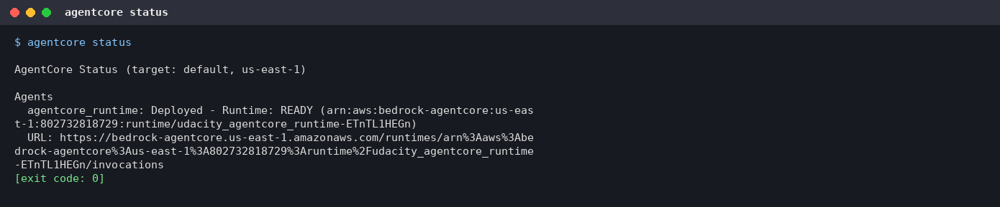
*`agentcore status`: runtime deployed and READY.*

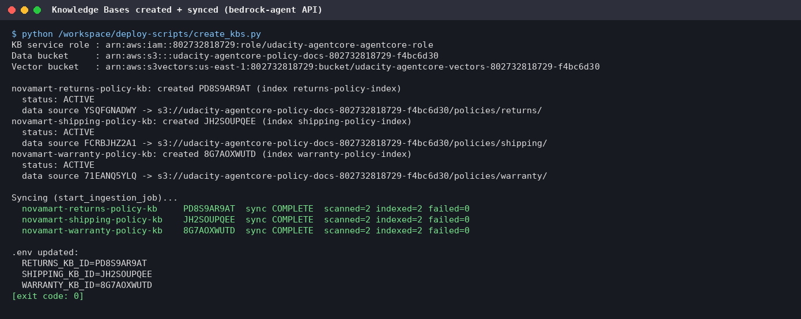
*Round 1: the three Knowledge Bases were created through the API and synced (ingestion COMPLETE, 0 failures).*

