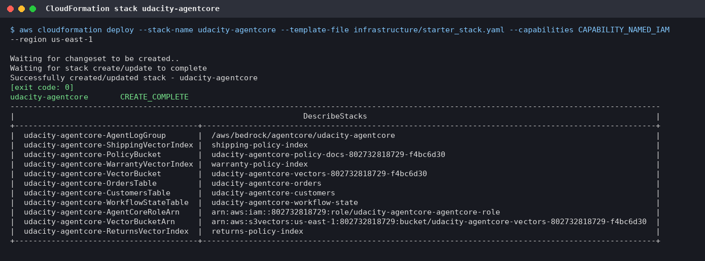
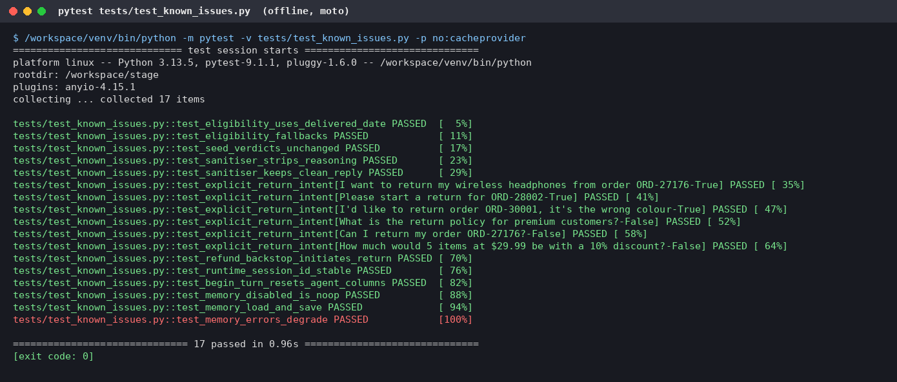
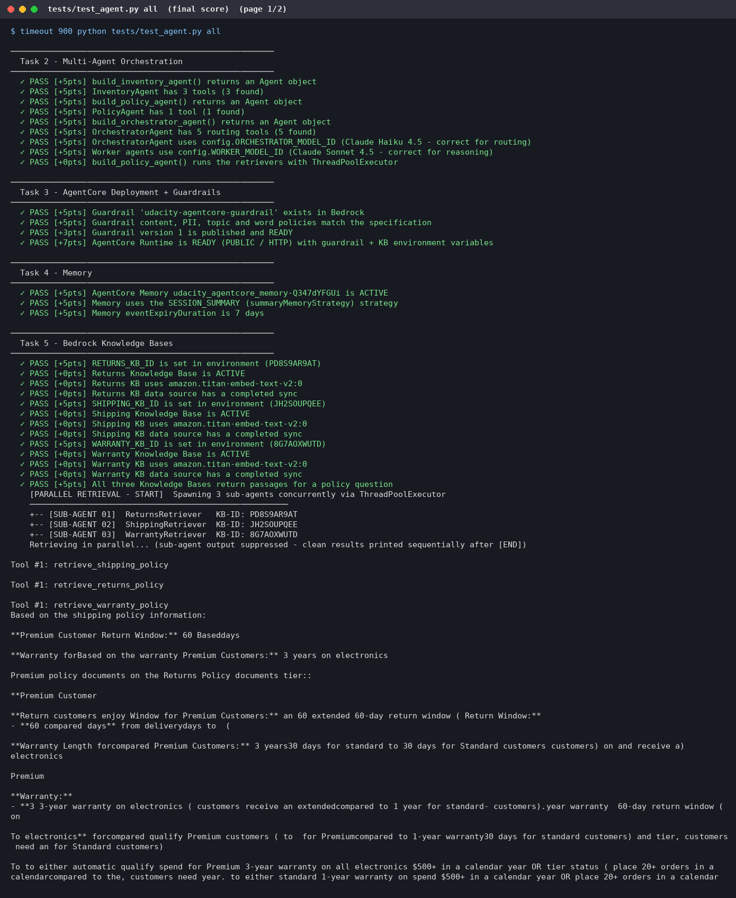

# Screenshot gallery

Captures from the live runs (us-east-1). Credentials scrubbed; account and resource IDs are not secrets. Back to [README](../README.md).

## Current deployment: account 015713577121, 14 Oct 2026

KBs created in the AWS console:

| File |
|---|
| [kb-list.png](screenshots/kb-console2/kb-list.png) |
| [returns-review.png](screenshots/kb-console2/returns-review.png) |
| [returns-synced.png](screenshots/kb-console2/returns-synced.png) |
| [shipping-review.png](screenshots/kb-console2/shipping-review.png) |
| [shipping-synced.png](screenshots/kb-console2/shipping-synced.png) |
| [warranty-review.png](screenshots/kb-console2/warranty-review.png) |
| [warranty-synced.png](screenshots/kb-console2/warranty-synced.png) |

Terminal captures (deploy, 120/120, runtime invocations, extras a-c):

| File |
|---|
| [30-deploy-p1.png](screenshots/run-2026-10-14/30-deploy-p1.png) |
| [30-deploy-p2.png](screenshots/run-2026-10-14/30-deploy-p2.png) |
| [31-test-task5-p1.png](screenshots/run-2026-10-14/31-test-task5-p1.png) |
| [31-test-task5-p2.png](screenshots/run-2026-10-14/31-test-task5-p2.png) |
| [32-test-all-p1.png](screenshots/run-2026-10-14/32-test-all-p1.png) |
| [32-test-all-p2.png](screenshots/run-2026-10-14/32-test-all-p2.png) |
| [33-agentcore-status.png](screenshots/run-2026-10-14/33-agentcore-status.png) |
| [40-adversarial-applyguardrail.png](screenshots/run-2026-10-14/40-adversarial-applyguardrail.png) |
| [41-session-store-turn1.png](screenshots/run-2026-10-14/41-session-store-turn1.png) |
| [42-session-store-recall.png](screenshots/run-2026-10-14/42-session-store-recall.png) |
| [43-test-all-after-session-store-p1.png](screenshots/run-2026-10-14/43-test-all-after-session-store-p1.png) |
| [43-test-all-after-session-store-p2.png](screenshots/run-2026-10-14/43-test-all-after-session-store-p2.png) |
| [44-offline-tests.png](screenshots/run-2026-10-14/44-offline-tests.png) |
| [45-adversarial-blocked.png](screenshots/run-2026-10-14/45-adversarial-blocked.png) |
| [46-adversarial-allowed.png](screenshots/run-2026-10-14/46-adversarial-allowed.png) |
| [47-runtime-invoke-return.png](screenshots/run-2026-10-14/47-runtime-invoke-return.png) |
| [48-runtime-invoke-policy.png](screenshots/run-2026-10-14/48-runtime-invoke-policy.png) |
| [49-runtime-invoke-math.png](screenshots/run-2026-10-14/49-runtime-invoke-math.png) |
| [50-session-turn1.png](screenshots/run-2026-10-14/50-session-turn1.png) |
| [51-session-turn2.png](screenshots/run-2026-10-14/51-session-turn2.png) |
| [52-session-ddb.png](screenshots/run-2026-10-14/52-session-ddb.png) |
| [53-local-test-p1.png](screenshots/run-2026-10-14/53-local-test-p1.png) |
| [53-local-test-p2.png](screenshots/run-2026-10-14/53-local-test-p2.png) |
| [53-local-test-p3.png](screenshots/run-2026-10-14/53-local-test-p3.png) |
| [53-local-test-p4.png](screenshots/run-2026-10-14/53-local-test-p4.png) |
| [53-local-test-p5.png](screenshots/run-2026-10-14/53-local-test-p5.png) |
| [53-local-test-p6.png](screenshots/run-2026-10-14/53-local-test-p6.png) |
| [54-test-all-final-p1.png](screenshots/run-2026-10-14/54-test-all-final-p1.png) |
| [54-test-all-final-p2.png](screenshots/run-2026-10-14/54-test-all-final-p2.png) |
| [55-dashboard-script.png](screenshots/run-2026-10-14/55-dashboard-script.png) |
| X-Ray trace map (cropped 2x / full) and traces list: [60-xray-trace-map.png](screenshots/run-2026-10-14/60-xray-trace-map.png) · [full](screenshots/run-2026-10-14/60-xray-trace-map-full.png) · [61-xray-traces.png](screenshots/run-2026-10-14/61-xray-traces.png) |
| Frontend (extra d): [64-frontend-login.png](screenshots/run-2026-10-14/64-frontend-login.png) · [65-frontend-signed-in.png](screenshots/run-2026-10-14/65-frontend-signed-in.png) · [66-frontend-return.png](screenshots/run-2026-10-14/66-frontend-return.png) · [67-frontend-followup.png](screenshots/run-2026-10-14/67-frontend-followup.png) · headless [62-frontend-e2e.png](screenshots/run-2026-10-14/62-frontend-e2e.png) |
| Round 4 (second review): [70-adversarial-r4-blocked.png](screenshots/run-2026-10-14/70-adversarial-r4-blocked.png) · [71-adversarial-r4-allowed.png](screenshots/run-2026-10-14/71-adversarial-r4-allowed.png) · [72-test-all-r4-p1.png](screenshots/run-2026-10-14/72-test-all-r4-p1.png) · [72-test-all-r4-p2.png](screenshots/run-2026-10-14/72-test-all-r4-p2.png) · [73-offline-r4.png](screenshots/run-2026-10-14/73-offline-r4.png) · [74-duplicate-return-r4.png](screenshots/run-2026-10-14/74-duplicate-return-r4.png) · [75-frontend-e2e-r4.png](screenshots/run-2026-10-14/75-frontend-e2e-r4.png) · [76-gitleaks-history.png](screenshots/run-2026-10-14/76-gitleaks-history.png) |
| Round 5 (third review): [80-adversarial-r5-blocked.png](screenshots/run-2026-10-14/80-adversarial-r5-blocked.png) · [81-adversarial-r5-allowed.png](screenshots/run-2026-10-14/81-adversarial-r5-allowed.png) · [82-math-3-runs.png](screenshots/run-2026-10-14/82-math-3-runs.png) · [83-test-all-r5-p1.png](screenshots/run-2026-10-14/83-test-all-r5-p1.png) · [83-test-all-r5-p2.png](screenshots/run-2026-10-14/83-test-all-r5-p2.png) · [84-offline-r5.png](screenshots/run-2026-10-14/84-offline-r5.png) · [85-frontend-e2e-r5.png](screenshots/run-2026-10-14/85-frontend-e2e-r5.png) · [86-xray-traces-r5.png](screenshots/run-2026-10-14/86-xray-traces-r5.png) |
| [dashboard/cloudwatch-dashboard.png](screenshots/dashboard/cloudwatch-dashboard.png) |

## Earlier deployment (account 802732818729, 26 Sep 2026)

| # | Step | Screenshot |
|---|---|---|
| 01 | CloudFormation stack deploy + outputs (round 1) | [01-stack.png](screenshots/01-stack.png) |
| 02 | `python config.py` (round 1) | [02-config.png](screenshots/02-config.png) |
| 03 | `seed_data.py` (round 1) | [03-seed.png](screenshots/03-seed.png) |
| 04 | Knowledge Bases created + synced (round 1) | [04-kb-sync.png](screenshots/04-kb-sync.png) |
| 05 | `test_agent.py task2`: 40/40 (round 1) | [05-test-task2.png](screenshots/05-test-task2.png) |
| 06 | `test_agent.py task5`: 25/25 (round 1) | [p1](screenshots/06-test-task5-p1.png) · [p2](screenshots/06-test-task5-p2.png) |
| 07 | `demo.py` (round 1) | [p1](screenshots/07-demo-p1.png) · [p2](screenshots/07-demo-p2.png) |
| 08 | Reseed (round 1) | [08-reseed.png](screenshots/08-reseed.png) |
| 09 | `agent_orchestrator.py test` (round 1) | [p1](screenshots/09-local-test-p1.png) · [p2](screenshots/09-local-test-p2.png) · [p3](screenshots/09-local-test-p3.png) · [p4](screenshots/09-local-test-p4.png) · [p5](screenshots/09-local-test-p5.png) · [p6](screenshots/09-local-test-p6.png) |
| 10 | `agent_orchestrator.py deploy` (round 2) | [10-deploy.png](screenshots/10-deploy.png) |
| 11 | `test_agent.py all`: 120/120 (round 2) | [p1](screenshots/11-test-all-p1.png) · [p2](screenshots/11-test-all-p2.png) |
| 12 | `invoke`: return scenario (round 2) | [12-invoke-return.png](screenshots/12-invoke-return.png) |
| 13 | `invoke`: policy scenario (round 2) | [13-invoke-policy.png](screenshots/13-invoke-policy.png) |
| 14 | `invoke`: maths scenario (round 2) | [14-invoke-math.png](screenshots/14-invoke-math.png) |
| 15 | `agentcore status` (round 2) | [15-agentcore-status.png](screenshots/15-agentcore-status.png) |
| 16 | DynamoDB order after the return invoke | [16-return-dynamodb.png](screenshots/16-return-dynamodb.png) |
| 17 | Same-session invoke: turn 1 | [17-session-turn1.png](screenshots/17-session-turn1.png) |
| 18 | Same-session invoke: turn 2 | [18-session-turn2.png](screenshots/18-session-turn2.png) |
| 19 | AgentCore Memory events + state | [19-memory-events.png](screenshots/19-memory-events.png) |
| 20 | `pytest tests/test_known_issues.py`: 17 passed | [20-unit-tests.png](screenshots/20-unit-tests.png) |
| 21 | X-Ray `Default` indexing rule (100%) | [21-xray-indexing.png](screenshots/21-xray-indexing.png) |
| 22 | X-Ray console: Trace/Service Map (1 h) | [22-xray-service-map.png](screenshots/22-xray-service-map.png) |
| 23 | X-Ray console: NovaMart-Orchestrator traces (8, all OK) | [23-xray-traces.png](screenshots/23-xray-traces.png) |
| 24 | Terminal: `tests/test_agent.py all` 120/120 with starter files restored | [24-test-all-terminal.png](screenshots/24-test-all-terminal.png) |
| 25 | Terminal: earlier tasks of the same run | [25-test-all-terminal-top.png](screenshots/25-test-all-terminal-top.png) |
| KB | Bedrock console: the three Knowledge Bases (list and details) | [kb-list](screenshots/kb-console/kb-list.png) · [returns](screenshots/kb-console/kb-returns-1.png) ([2](screenshots/kb-console/kb-returns-2.png)) · [shipping](screenshots/kb-console/kb-shipping-1.png) ([2](screenshots/kb-console/kb-shipping-2.png)) · [warranty](screenshots/kb-console/kb-warranty-1.png) ([2](screenshots/kb-console/kb-warranty-2.png)) |

